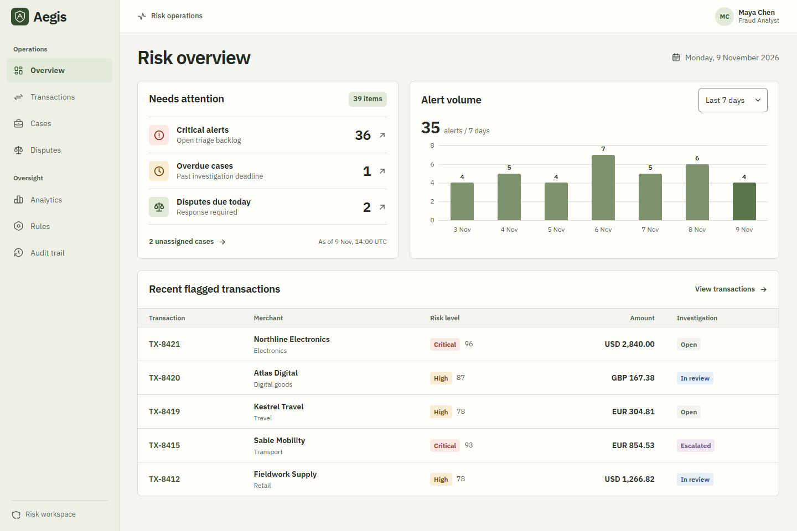

# Aegis

Aegis is a browser prototype for enterprise fraud and risk operations. It follows a Fraud Analyst from alert triage through evidence review, a recorded decision, and the audit trail. A separate dispute workflow covers linked case assignment and evidence review.



## Run locally

Use Node.js 24 LTS and npm.

```sh
npm ci
npm run dev
```

Open the URL printed by Vite. For the production bundle use `npm run build` and `npm run preview`.

## Walk through the prototype

- **Investigate.** From Overview, open Critical alerts and select `TX-8421`. Open Authorization record and Device and session record in Evidence and mark both reviewed. Select Block payment or Clear alert, enter a reason of at least 12 characters, and review the outcome before confirming. The linked `CS-2401` and Audit trail show the update.
- **Resolve a dispute.** From Disputes, open `DP-6101`. Assign the linked case, review the three evidence items, and select Challenge dispute with a reason. Cancel or confirm from the review dialog. The dispute, case and audit event update together.
- **Test a rule.** Open `RULE-103`, change the threshold and run a test. Review the match count and configuration before publishing. `RULE-104` illustrates a Risk Manager permission boundary.

## Demo data

The dataset is fictional and anchored to 9 November 2026 at 14:00 UTC. Transactions use original currencies, so amount sorting groups by currency. Alerts preserve the conditions at intake, and changing a rule updates configuration for testing without rewriting historical alerts. Decisions operate on the synthetic records in this browser.

To reset your local workspace, close other Aegis tabs and run this in the browser console on the Aegis origin:

```js
localStorage.removeItem('aegis.workspace.v1')
location.reload()
```

If the saved dataset is unreadable, the recovery screen provides a confirmed restore. Local storage holds one versioned workspace, and Web Locks serializes writes in supporting browsers. The revision check rejects stale reviews. No network calls send payments, submit disputes, or change banking rules. Identity, authorization, protected rules and audit integrity are modeled within the frontend. Use fictional text in notes and reasons.

## Checks

```sh
npm run lint
npm run typecheck
npm run build
npx playwright install --only-shell chromium
npm test
```

On Windows set `$env:AEGIS_BROWSER='msedge'` in PowerShell to use installed Edge. Set `AEGIS_CAPTURES` to an output directory before running the suite to capture the viewport and theme matrix. See [QA](docs/QA.md) for the verified coverage and limits.

- [Portfolio case study](docs/CASE-STUDY.md)
- [Research, flows and direction comparison](docs/PRODUCT-DESIGN.md)
